# Projet : Pendu Client-Serveur

Application de pendu Java fonctionnant en architecture client-serveur

---

## 📝 Présentation

Ce projet est un projet d'etudes dont l'objectif était de concevoir un jeu du pendu en Java client-serveur où il est possible de se connecter au  serveur pour demarrer une partie,via le client.Il a été conçu en license bien avant mon master IHM.

### ✨Fonctionnalités

Ce pendu possède de nombreuses fontionnalités qui ont dû être développées dans un laps de temps limité ce qui a donné quelques fontionalités incomplètes malgré une majorité de fonctionnalités fonctionnelles.

- **Authentification**
  
  - Utilisez un identifiant et un mot de passe pour jouer au pendu et sauvegarder vos parties.

- **Partie contre le serveur :**
  
  - <u>Paramètres personnalisés :</u>
    
    - Longueur aléatoire ou définie du mot
    
    - Nombre d'échecs tolérés (erreurs)
    
    - Limitation du temps pour trouver le mot
  
  - <u>Clavier interactif :</u>
    
    - Un clavier est diponible pour selectionner une lettre et devient rouge ou vert lorsqu'on clique dessus.

- **Sauvegarde et chargement des parties interrompues :**
  
  - Le jeu sauvegarde les parties solo interrompues pour pouvoir les reprendre par la suite. (incomplet)

- **Jeu multijoueur :**
  
  - <u>Création de salons :</u>
    
    - Possibilité de créer des salons pour que les joueurs connectés essaiuent de deviner le mot de l'hôte.
  
  - <u>Rejoindre un salon :</u>
    
    - Possibilité de rejoindre un salon existant afin de commencer un partie multijoueur.
  
  - <u>Chat :</u>
    
    - Un chat permet de discuter avec les joueurs.  (incomplet)

---

### 🖼️ Captures d'écrans

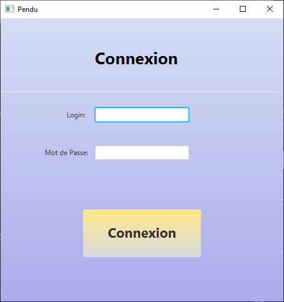

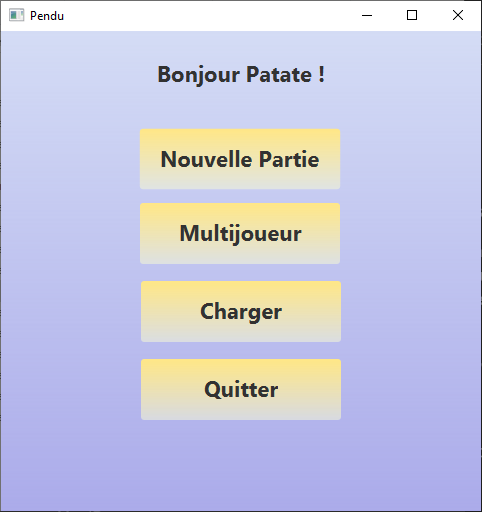

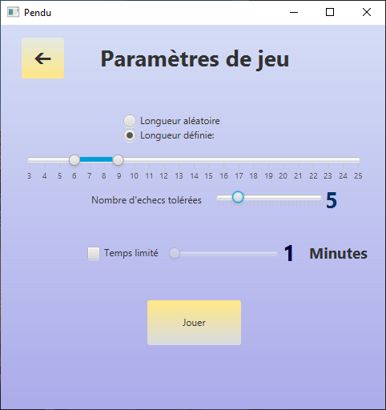

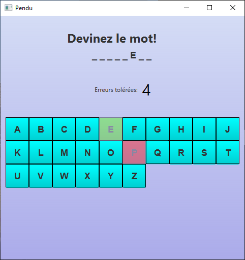

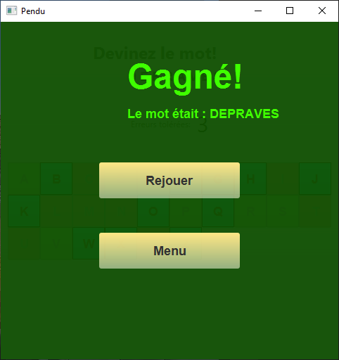

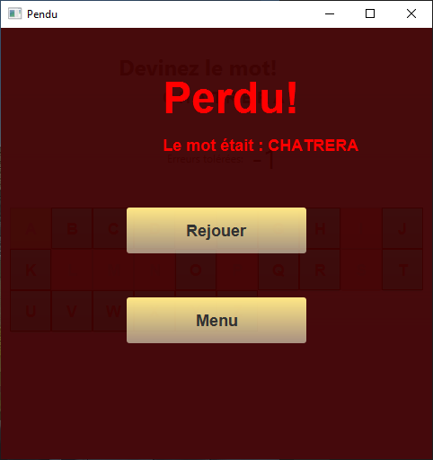

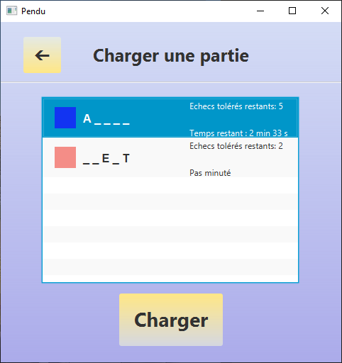

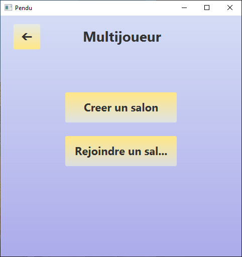

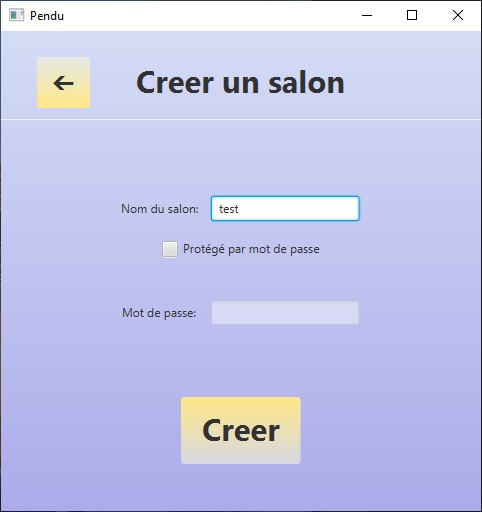

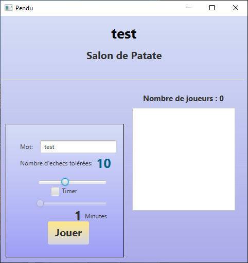

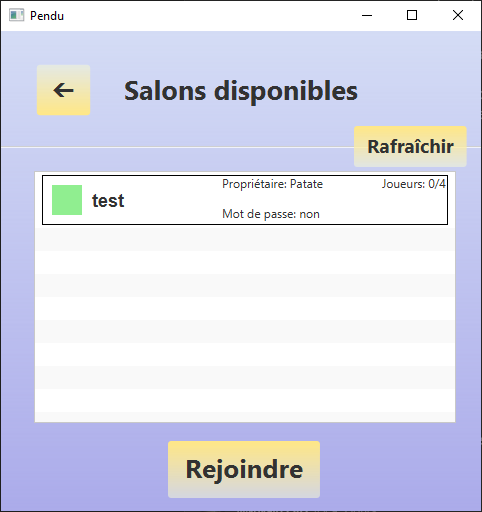

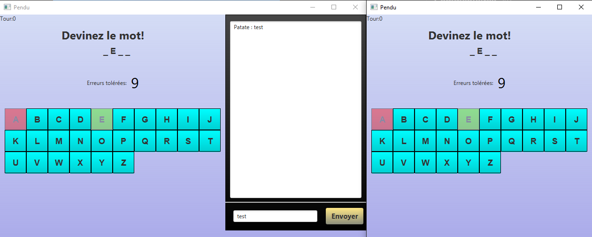

### Stack Technique

* **Langage** : Java
* **Framework/Lib** : JavaFX
* **IDE** : IntelliJ

---

## ⚙️ Installation

Suivez ces étapes pour mettre en place votre environnement de développement.

### Prérequis

* **Systeme d'exploitation** : Windows 10 ou 11

### Étapes d'installation

1. Clonez le dépôt.
2. Pour démarrer une instance client lancez run-client.bat et pour démarrer une instance serveur lancez run-serveur.bat
